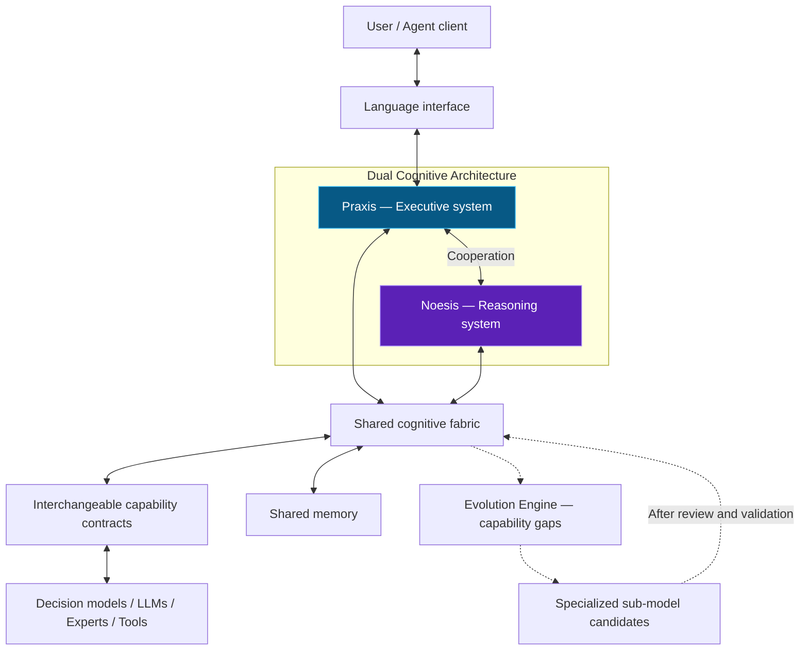
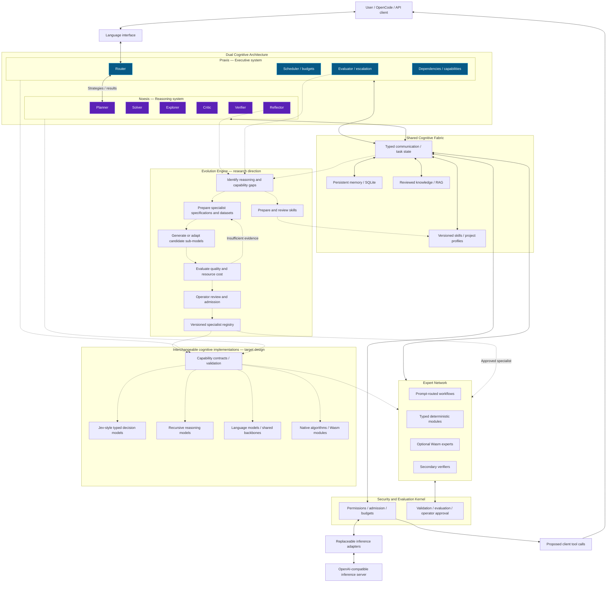
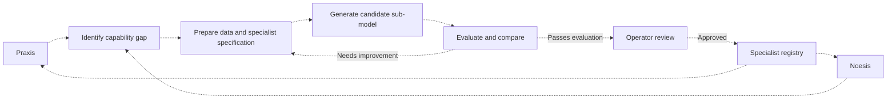

<div align="center">
  

  <h1>Cognitive Fabric</h1>

  <p>
    <i>Intelligence through architecture, not just scale.</i>
  </p>
</div>

[](https://github.com/DrapNard/cognitive-fabric/actions/workflows/ci.yml?query=branch%3Adevelop%2Fv1.0)
[](https://www.rust-lang.org/)
[](LICENSE)

Cognitive Fabric (CGF) is an experimental, local-first cognitive runtime written in Rust. It brings interchangeable decision models, language models, specialized workflows, deterministic computation and persistent knowledge together within explicit resource budgets. Its cognitive blocks are defined by their functional contracts rather than by a fixed model family.

Rather than relying on a single increasingly large model, CGF investigates whether cooperating components can solve complex tasks effectively on consumer hardware. Its long-term vision goes beyond orchestration: the fabric should be able to identify gaps in its own reasoning and capabilities, generate specialized sub-model candidates, and integrate validated candidates to extend its cognitive repertoire.

> **Pre-release alpha.** CGF is an orchestration runtime, not a newly trained foundation model. Its research hypotheses have not yet been independently validated. No claim of general reasoning superiority, lower energy consumption or production readiness is made.

[Quick start](#quick-start) · [Architecture](#dual-cognitive-architecture) · [Modularity](#modular-and-interchangeable-by-design) · [Foundations](#architectural-foundations) · [Cognitive expansion](#cognitive-expansion--evolution-engine) · [Evaluation](#evaluation) · [Roadmap](docs/ROADMAP.md) · [Contributing](#contributing)

## Dual Cognitive Architecture

Two complementary cognitive systems form the core of the design: **Praxis** for executive coordination and **Noesis** for reasoning. Neither is conceptually subordinate to the other. They cooperate through the fabric, with concurrency subject to dependencies, runtime budgets and available resources.



| System | Responsibility |
| --- | --- |
| **Praxis** | Routing, execution coordination, resource budgets and escalation |
| **Noesis** | Planning, solving, exploration, criticism, verification and reflection |
| **Cognitive Fabric** | Structured communication, task state, shared knowledge and skill metadata |
| **Evolution Engine** | Experimental generation and evaluation of specialized sub-models to extend reflection and capabilities |

> [!NOTE]
> Praxis and Noesis are the new public names for Jev+ and Jev-R respectively. Existing source identifiers, command-line flags and documentation may still use the original names. The diagram describes the intended architecture; it does not assert that every depicted interaction or parallel execution path is already implemented.

<details>
<summary><strong>Explore the detailed architecture</strong></summary>



This is a logical target design, not a process-level execution trace. Dashed edges represent research directions. Role separation does not require separate neural networks or simultaneous model residency. The HTTP client remains responsible for authorizing and executing proposed client tools.

See the [architecture design](docs/ARCHITECTURE.md), [implementation snapshot](docs/CURRENT_IMPLEMENTATION.md) and [implementation matrix](docs/IMPLEMENTATION_MATRIX.md) for actual coverage and limitations.

</details>

## Modular and interchangeable by design

**The model is an implementation. The capability is the abstraction.**

Praxis and Noesis are complementary cognitive systems, not fixed neural architectures. The intended unit of composition is a functional block: routing, scheduling, planning, solving, exploration, criticism, reflection or verification. Each block has a defined responsibility and an interface contract. Any suitable Jev-style decision model, language model or computational component may implement that role if it satisfies the relevant contract; compatibility is determined by behavior, not by the model's name or parameter count.

| Contract aspect | Purpose |
| --- | --- |
| Inputs and outputs | Typed requests, expected decisions or results, and explicit failure states |
| Capabilities | Supported tasks and the functional requirements of the role |
| Validation | Checkable outputs, evaluation evidence and admission criteria |
| Resource profile | Context, latency, memory and compute requirements within runtime budgets |
| Lifecycle | Versioned identity, activation, replacement and rollback where supported |

The target architecture supports independently replacing, composing, sharing and selectively activating cognitive blocks. A single backbone can serve several roles, while specialized implementations can be used when their measured benefits justify their cost. Neural blocks and deterministic blocks are complementary; a language model is not required for a task that can be solved reliably by native computation.

CGF already exposes replaceable OpenAI-compatible inference adapters, configurable role models, deterministic modules and expert workflows. Universal block interchangeability and native support for arbitrary Jev-style decision models are architectural objectives, not guarantees that every model works without an adapter or evaluation.

## Architectural foundations

CGF draws on several complementary research directions rather than prescribing a single neural architecture:

| Research direction | Intended contribution |
| --- | --- |
| Jev-style typed decision models / System One | Structured decisions, routing, selection and fast executive coordination |
| NanoJev | Historical inspiration for the original Jev+ design and early decision-model experiments proposed for Jev-R |
| Tiny Recursive Models (TRM) and Hierarchical Reasoning Models (HRM) | Inspiration for iterative, recursive and hierarchical reasoning in Noesis |
| Neuro-symbolic computation | Neural inference combined with deterministic solvers, typed state and independently checkable results |
| Adaptive cognitive expansion | Generation and evaluation of specialized sub-models to address gaps in reasoning and reflection |

Historically, the initial Jev+ concept explored a NanoJev-derived decision model, while Jev-R explored decision models combined with recursive search and later TRM/HRM-inspired neural designs. These are design inspirations, not a claim that the current Rust runtime is a fork of those implementations. The documented alpha instead uses orchestration, bounded reasoning algorithms and replaceable external inference; trained Praxis and Noesis networks are not distributed.

Neither Praxis nor Noesis is restricted to one model family. A compatible decision model can serve either system where its capabilities fit the role. Recursive reasoning can be implemented through algorithms and repeated model calls without requiring a dedicated recursive neural network. Native integrations with specific third-party decision models must be established and evaluated separately.

See [architecture design](docs/ARCHITECTURE.md) and [current implementation](docs/CURRENT_IMPLEMENTATION.md) for the distinction between design and implementation.

## Philosophy

CGF investigates resource-efficient intelligence through modularity, bounded reasoning, selective activation and independently checkable results. Components should be replaceable, external effects should remain under explicit authority, and improvements should be tested at comparable resource budgets. A shared backbone is preferable when separate models do not justify their additional cost. Cognitive expansion is therefore selective: new specialist models should complement existing reasoning rather than duplicate it, and their value should be demonstrated against the existing fabric at comparable resource budgets.

## Cognitive expansion — Evolution Engine

CGF is designed to investigate **adaptive cognitive expansion**, not merely the coordination of a fixed collection of models. When Praxis or Noesis encounters a persistent capability gap, the Evolution Engine is intended to prepare a specialized sub-model that complements the existing systems, including their ability to reflect, reason and verify results.

A sub-model is a neural specialist candidate, distinct from a prompt-routed workflow, a deterministic module or a stored skill. Candidate creation may involve fine-tuning, distillation or lightweight adapters, depending on the task and available resources; these are proposed research approaches rather than a commitment to a specific training method.



The intended lifecycle is:

1. **Discover:** identify recurring failures, missing domain knowledge or weaknesses in reflection using task evidence.
2. **Specify:** define the missing capability, training material, evaluation criteria and resource budget.
3. **Generate:** prepare or adapt a small specialist model candidate rather than necessarily expanding the primary backbone.
4. **Evaluate:** compare the candidate against the existing system on held-out tasks, including quality, latency and memory cost.
5. **Admit:** require operator review before registering and activating a versioned candidate; retain the ability to reject or roll back it.
6. **Cooperate:** make approved specialists available to Praxis and Noesis through the fabric, selectively and within runtime budgets, by binding them to compatible functional contracts.

This feedback loop is a research objective: cognitive systems can potentially extend their collective capabilities without continually increasing the size of a single model. It is not a claim that CGF currently trains or deploys new neural networks autonomously, nor that recursive improvement or quality gains have been demonstrated. Existing skill preparation, model lifecycle controls and training preflight should not be confused with a complete sub-model generation pipeline.

## Features

- Rust runtime built with Tokio, FlatBuffers and SQLite; typed local IPC over owner-restricted Unix sockets.
- Deterministic routing, bounded FAST / STANDARD / DEEP / RESEARCH modes, recovery and structured checks.
- Replaceable OpenAI-compatible inference adapters and an offline demonstration backend.
- Persistent task state, reviewed knowledge and versioned skill metadata.
- Operator-approved model lifecycle, response-instance validation, typed modules, optional bounded Wasm experts, secondary verifiers and immutable project profiles.
- Optional loopback HTTP API for agent clients; clients retain tool execution and authorization.

Explore [typed modules](docs/TYPED_MODULES.md), [Wasm experts](docs/WASM_EXPERTS.md), [project profiles](docs/PROJECT_PROFILES.md), [managed residency](docs/MANAGED_RESIDENCY.md) and [verification](docs/VERIFICATION.md).

## Quick start

### Requirements

- Stable Rust (selected by `rust-toolchain.toml`, without an exact compiler version pin).
- C compiler and linker for native dependencies and SQLite.
- Linux or another supported Unix-like platform for socket workflows.
- An OpenAI-compatible local inference server for model-backed tasks; not needed for the offline demo.

Committed FlatBuffers bindings are checked against the pinned runtime. Install `flatc` only if regeneration is needed; see [protocol generation](docs/PROTOCOL.md).

### Try the offline demo

```sh
git clone --branch develop/v1.0 https://github.com/DrapNard/cognitive-fabric.git
cd cognitive-fabric
cargo build --locked
cargo run -- ask 'calc: (7 + 5) * 3'
cargo run -- --json security-eval
```

### Connect a local model

Use the model identifier and API endpoint exposed by your inference server:

```sh
cargo run -- configure-local \
  --model your-loaded-model-id \
  --api-base http://127.0.0.1:1234/v1
cargo run -- ask 'Explain Rust ownership briefly.' --mode standard
```

## Installation

There are currently no precompiled release binaries. Review the installer and revision before executing it. The following builds the CLI, chat CLI and optional HTTP server under `$HOME/.local` without root privileges:

```sh
curl -fsSLo setup.sh https://raw.githubusercontent.com/DrapNard/cognitive-fabric/develop/v1.0/scripts/setup.sh
less setup.sh
sh setup.sh --ref develop/v1.0 --prefix "$HOME/.local"
```

For reproducibility, substitute the same reviewed full commit ID in both the download URL and `--ref`. Existing binaries are retained unless `--replace` is provided. See [installation](docs/INSTALL.md) and [installation validation](docs/INSTALLATION_VALIDATION.md).

<details>
<summary><strong>Advanced model configuration and expert workflows</strong></summary>

For a Qwen language interface with compiled Noesis solvers, add `--language-model MODEL_ID --jev-r-only` to the installer. This writes routing configuration, not model weights.

To share a reasoning backbone across roles and enable the example domain workflows:

```sh
sh setup.sh --ref develop/v1.0 --prefix "$HOME/.local" --replace \
  --language-model qwen/qwen3-8b \
  --reasoning-model qwen3.6-35b-a3b \
  --domain-experts --native-on-demand \
  --parallelism 2 --expert-parallelism 2
```

Override individual roles with repeated `--role-model ROLE=MODEL` arguments (`planner`, `solver`, `explorer`, `critic`, `reflector`). Other roles inherit `--reasoning-model`; routes use the configured API base.

The example domain experts are prompt-routed workflows, not independently trained or validated expert networks. The installer configures CLI and OpenCode homes but does not start LM Studio, perform inference or guarantee simultaneous model residency.

To bind Praxis workflows to a separate registered model, supply `--domain-expert-manifest /absolute/path/to/model-manifest.json`. The manifest is registered in both homes, and new workflow versions bind to its immutable model selection. Its API base must match `--api-base`, context must be at least 16384 tokens and the model key must differ from the language-only route. The default workflow version is `1.1.0`; use `--domain-expert-workflow-version VERSION` when rebinding.

`--native-on-demand` includes the selected expert in the private activation policy and saves an unapproved policy draft for OpenCode. Review it, start LM Studio and invoke `cogfabric-opencode-on-demand` to authorize first-use loading for that session. Ordinary `cogfabric-opencode` startup is unchanged.

</details>

## Integrations

CGF exposes an optional OpenAI-compatible local HTTP interface for OpenCode and other agent clients. See [client integration](docs/AGENT_CLIENTS.md), [HTTP API](docs/HTTP_API.md) and [OpenCode configuration](docs/HTTP_API.md#opencode-v2-configuration).

Use `cogfabric-chat` for bounded text-only conversation alongside an agent client sharing the same inference server. Chat does not execute tools. After reboot, start the model provider before running `cogfabric-opencode`. See [chat](docs/CHAT.md) and [startup and troubleshooting](docs/OPENCODE.md).

In chat, `/effort` displays the reasoning setting; `/effort low`, `/effort medium`, `/effort high`, `/effort none` and `/effort default` update it for later turns without changing models. OpenCode uses per-request effort variants.

Further setup: [configuration](docs/CONFIGURATION.md), [authentication](docs/AUTHENTICATION.md), [workers](docs/WORKERS.md).

## Resource management

Coordination, reasoning orchestration, deterministic checks, storage and IPC execute on the CPU. The default build and offline demo do not require CUDA. Model computation and offloading are managed by the external inference server, not a CUDA inference engine inside CGF.

- Optional NVIDIA observations: `diagnostics --probe-gpu`, `compare --observe-gpu`, `--features nvml-gpu` or installer `--nvml-gpu`. See [GPU observations](docs/GPU_OBSERVATIONS.md). Device observations do not establish inference execution, task energy or physical GPU limits.
- Approved [native lifecycle policies](docs/NATIVE_ON_DEMAND.md) can activate models on demand, reuse validated instances and release instances they own. See also [operator guidance](docs/NATIVE_LIFECYCLE.md).
- [Shared inference resource pools](docs/RESOURCE_SCHEDULING.md) bound concurrent operations and declared allocations across trusted Rust hosts. Configure CLI/service use with `configure-resources FILE`. Optional backbone declarations reserve shared memory separately and reject undeclared inference targets.
- Linux [worker limits](docs/WORKER_LIMITS.md) can restrict CPU time and virtual address space of managed processes.
- The [reviewed residency planner](docs/RESIDENCY_PLANS.md) reuses loaded contexts and proposes model-set changes for approval. Physical GPU enforcement and measured residency remain incomplete.
- Optional [exact input-token admission](docs/INPUT_TOKEN_ADMISSION.md) supports native llama.cpp text inference with persistent task input allowances.

## Security and deployment scope

CGF currently targets local, single-user operation. Its optional HTTP server listens on loopback and lacks multi-tenant isolation; do not expose it directly to untrusted networks. Managed workers are not a general sandbox for hostile code. The runtime cannot establish that cancellation stopped provider GPU work, and forks may remove local policy.

Treat prompts, retrieved data, model output, datasets and skill artifacts as untrusted. Model output cannot authorize actions. Retrieval validation does not establish neural safety. The documented threat model includes a live reference-content prompt-injection failure and mitigation limits.

See [security](docs/SECURITY.md), [threat model](docs/THREAT_MODEL.md) and operator-approved [remote source acquisition](docs/SOURCE_ACQUISITION.md), which imports hash-pinned HTTPS text into unreviewed preparation bundles.

## Evaluation

The research question is whether a cooperating system can improve task success at comparable compute, memory and time budgets. Current evidence includes deterministic integration tests, fixed security probes and public model workflow reports. Authored evaluation corpora are diagnostic, not independent held-out proof of quality gains.

Review the [benchmark methodology](docs/BENCHMARKING.md), [corpus notes](evaluation/README.md) and [release audit](docs/RELEASE_AUDIT.md).

```sh
cargo fmt --all -- --check
cargo check --workspace --all-targets
cargo test --workspace --all-targets
cargo clippy --workspace --all-targets -- -D warnings
```

[CI](.github/workflows/ci.yml) additionally checks generated protocol bindings, CLI workflows, the optional HTTP workflow and offline training preflight.

Experimental [retry evaluation](docs/EMPIRICAL_ESCALATION.md) and [reviewed workflow routing](docs/EMPIRICAL_WORKFLOW_ROUTING.md) use reviewed success/cost evidence within runtime limits; quality improvement is not established. Future specialist-model evaluation should additionally compare the fabric before and after admission, using held-out tasks and equivalent resource budgets. Pin a reviewed workflow policy via `ask` or `serve` with `--workflow-study STUDY --workflow-thresholds LIMITS`.

Verifier-R supports [finite-domain assignments](docs/VERIFICATION.md#finite-domain-assignments) with `csp:` objectives, as well as sorting, ordering and path checks.

## Project status and roadmap

CGF is actively developed. Neural adaptation is experimental and optional; trained Praxis or Noesis networks are not distributed. The Evolution Engine’s proposed end-to-end generation, evaluation, admission and reuse of specialized sub-models for cognitive expansion remains a research objective, not an established autonomous capability. The opt-in [client collective](docs/CLIENT_COLLECTIVE.md) persists bounded reasoning state over correlated client tool turns. Universal capability-contract interchangeability and native decision-model integrations remain areas for further implementation and validation. Broader Engine expert and project-profile integration, general module lifecycle, residency scheduling, independent held-out evaluation and stronger isolation remain incomplete.

Optional image, audio and tentative video understanding are planned after core completion. See the [delivery roadmap](docs/ROADMAP.md), [implementation matrix](docs/IMPLEMENTATION_MATRIX.md), [current implementation](docs/CURRENT_IMPLEMENTATION.md) and [release audit](docs/RELEASE_AUDIT.md).

## Contributing

Feedback, reproducible experiments, bug reports and contributions are welcome. Particularly useful areas include resource-efficient local inference, deterministic verification, specialist workflows, compact specialist-model training and evaluation, cognitive expansion, evaluation methodology and Rust runtime engineering.

Open an [issue](https://github.com/DrapNard/cognitive-fabric/issues) to discuss a proposal or report a problem. Include the revision, configuration, hardware and reproduction steps when relevant. Run the checks above before submitting a change. Distinguish measured results from hypotheses and avoid including credentials or private data in reports.

## License

The current source tree is licensed under **GNU GPL version 3 only** ([LICENSE](LICENSE)). Project-authored evaluation datasets and certain examples have explicit license metadata; third-party models and imported datasets retain their own terms. Earlier commits and tags retain the licenses recorded at those revisions; permissions previously granted are not withdrawn.
