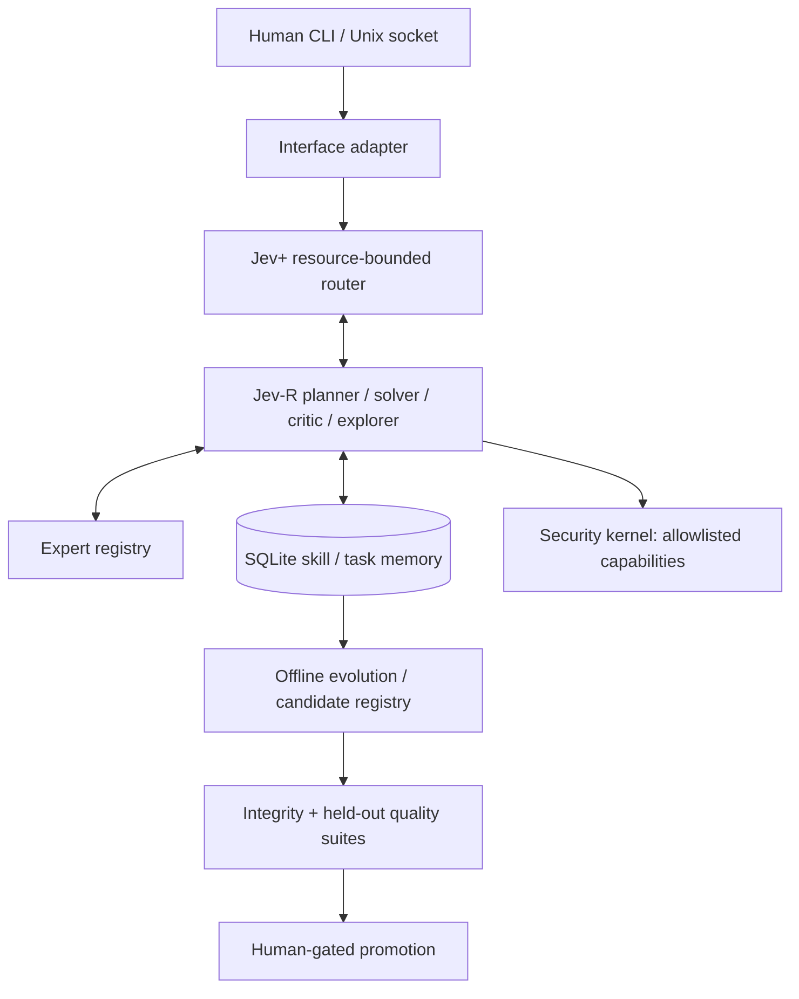

# Architecture (v1.0 runtime)

## Delivered components

- Versioned, max-size-bounded MessagePack binary envelope with 4-byte network-order length.
- Local Unix-domain socket daemon with least-privilege file permissions.
- Durable SQLite WAL task/event/skill/document/candidate/evaluation stores and FTS5 retrieval.
- Deterministic Jev+-inspired skill routing and bounded Jev-R role loop.
- Backends: deterministic demo and localhost OpenAI-compatible chat inference.
- Explicit allowlisted calculator tool, no arbitrary code execution.
- Human-invoked data ingestion with source and license.
- Artifact lifecycle with integrity and candidate-specific retrieval tests; explicit human-gated RAG activation.
- Optional manual offline LoRA training script; no automatic weight updates.
- Performance baseline harness with task-level timings and model call counts.

## Not delivered / research areas

- Learned Jev+ / Jev-R networks, TRM/HRM-trained reasoning or shared latent states.
- FlatBuffers runtime (`protocol/cognitive.fbs` is a migration-ready proposal only).
- Multi-GPU scheduling, physical VRAM telemetry or accurate GPU energy accounting.
- Automated model-data harvesting or hands-off training/deployment.
- Neural-weight security certification, independent red-team assessment.
- Hot activation or promotion of LoRA weights (registration/training experiments only).
- Performance parity with any commercial frontier model.

The initial implementation is deliberately Python so it can be executed and
verified without a Rust toolchain. Rust/FlatBuffers may replace the bus later
without changing the logical Envelope contract.
