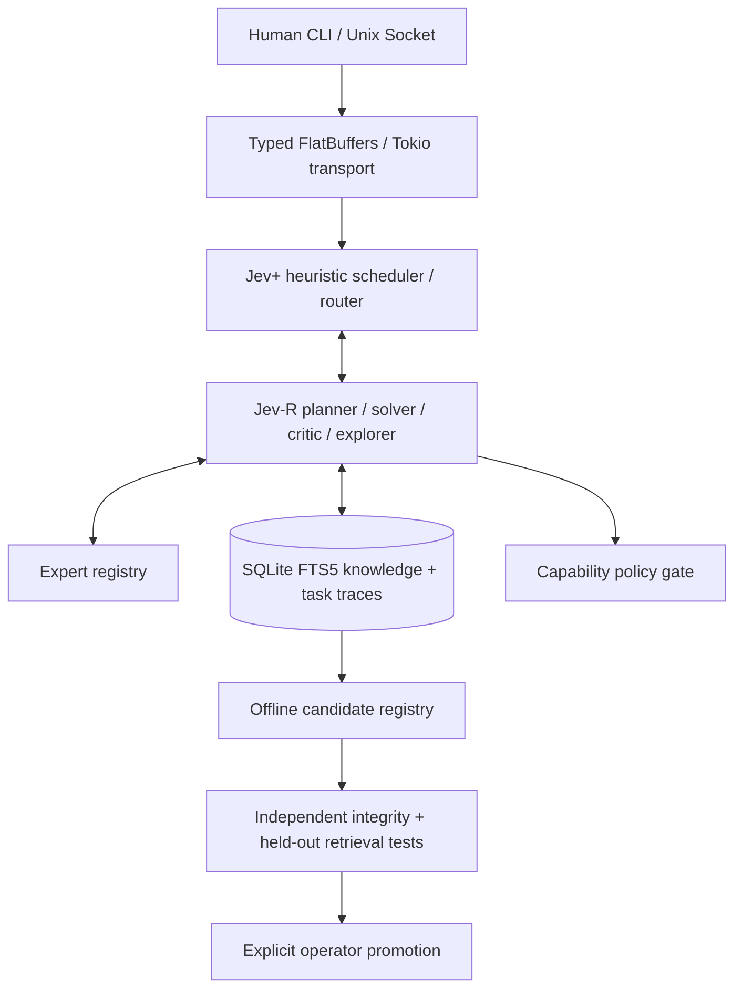

# Architecture (Rust alpha)

All runtime components are Rust 2021. The generation/LLM interface uses a local
OpenAI-compatible API and requires an externally installed model. The training
recipe under `training/` remains Python by design and is not invoked by the Rust
runtime. FlatBuffers is used for Unix socket IPC, **not** the LLM HTTP JSON API.

The current Jev+ and Jev-R roles are algorithms and repeated model calls, not
newly trained neural architectures. No general intelligence benchmark or scale
advantage has been demonstrated. There are no arbitrary tool invocations,
automatic model deployments or untrusted command execution paths.

The port is presently uncompiled. See `docs/RUST_PORT.md` before release.
